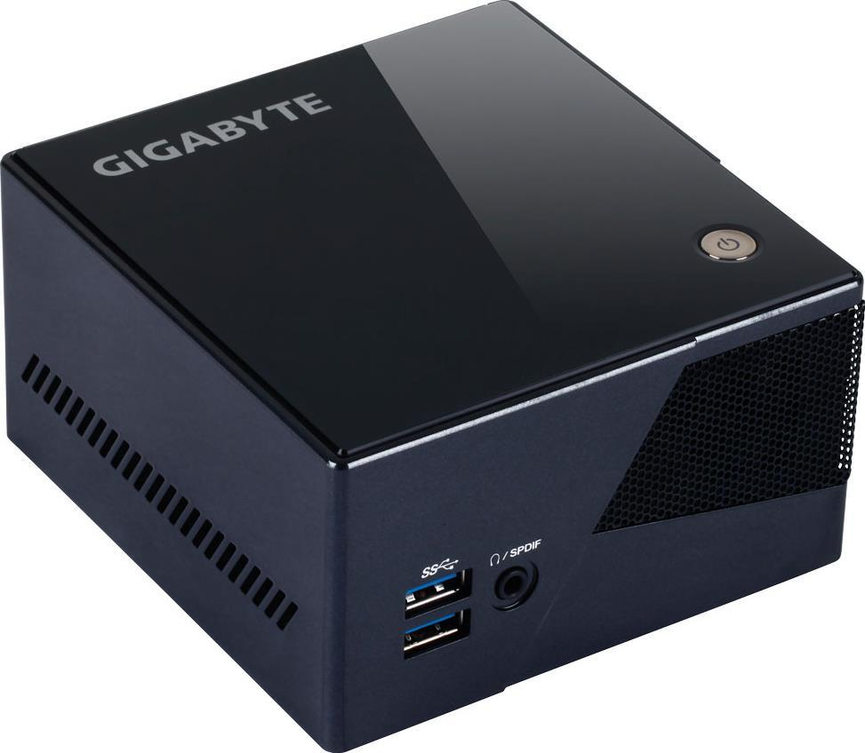
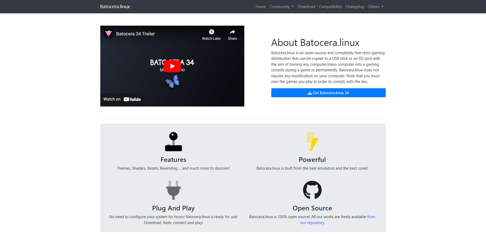
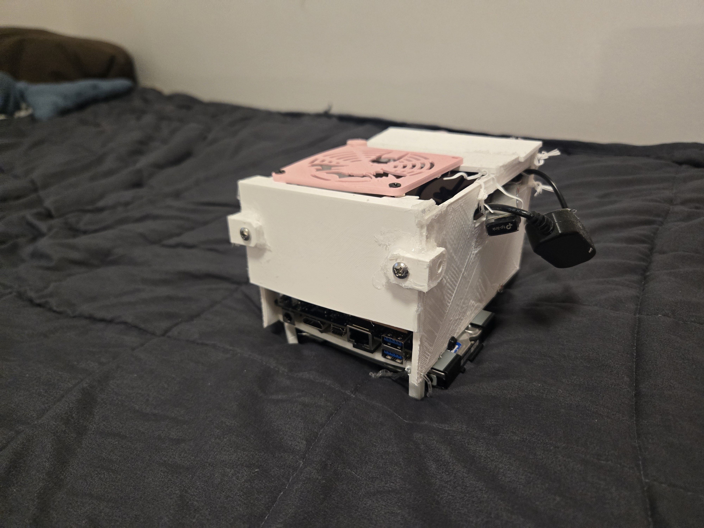
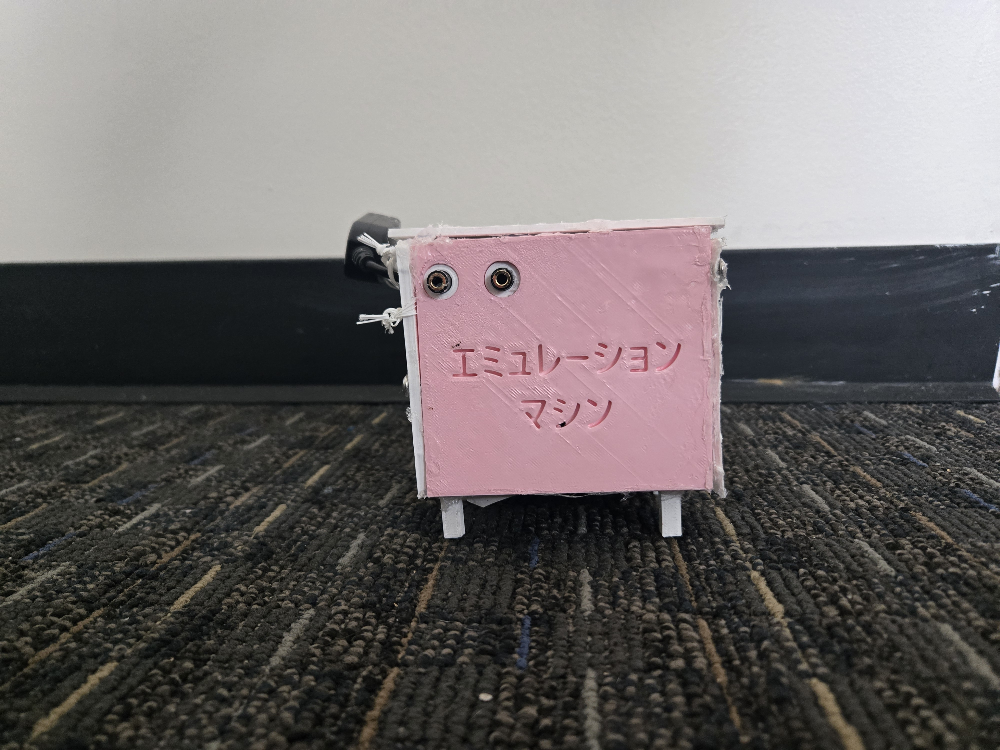
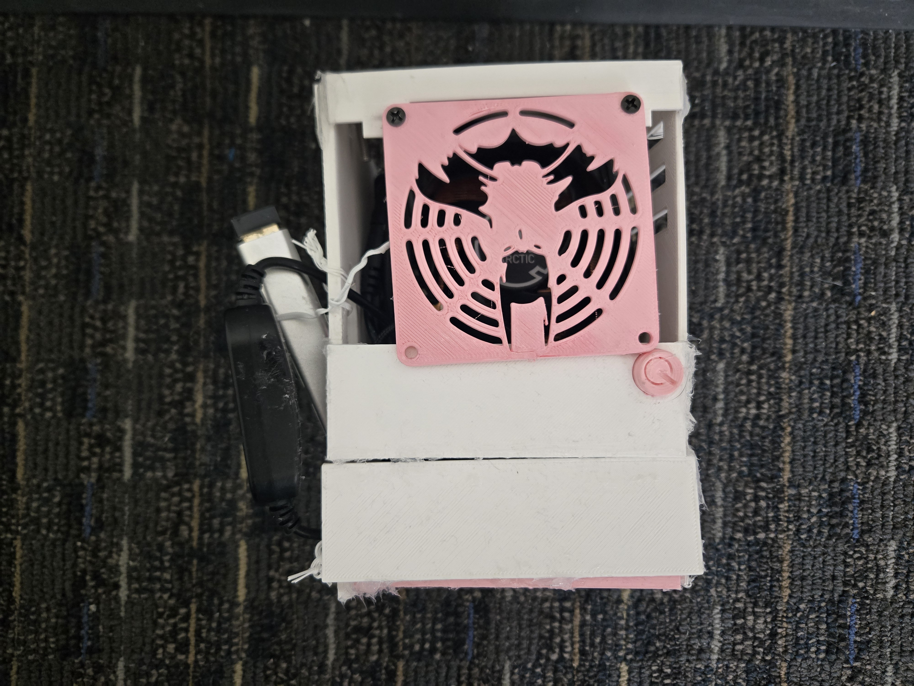
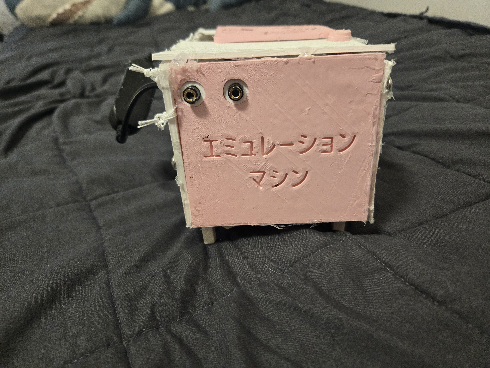
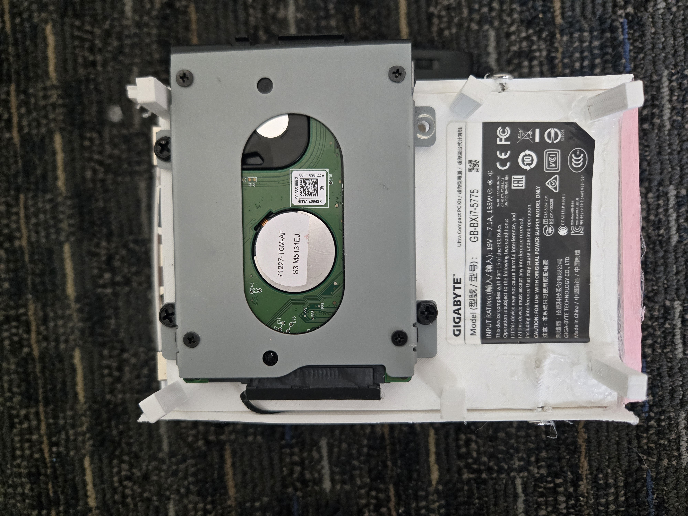

Sitting on the couch, my friends on either side, I realize that I am truly bored. We've played the same game over and over, until the point where every time we hang out, we move on instinct to just throw it on in the background. I can tell by the look on their faces that they're bored too.

My entire life, I have loved to play video games. In fact, I think that video games as a medium have shaped my values and personal life more than any other kind of media. However, I'll be the first to admit that they have a major longevity problem. Sure, masterpiece popular games like Minecraft enter the social zeitgeist and never leave, but games that don't receive the same treatment tend to almost always fall into obscurity. 

A game I personally consider a masterpiece is Halo: Reach. There is so much to love about the game, from the innovative freeplay systems to the pure euphoria of being able to play a fast-paced competitive playground with someone sitting right beside you in real life. I love this game. But in my personal life, not a single person I have ever met even seems to know it exists. Its older brother, Halo 3, seems to receive all of the credit for its beautiful story and gameplay, instead. Don't get me wrong, I love that game too, but Halo: Reach has a better story and better gameplay.

But when I go over to another person's house in 2026, they are not going to have Halo: Reach. Unlike its brothers in the Master Chief Collection (a remaster of the first three Halo games), Halo: Reach never received an update or contemporary edition. This, in essence, means that it is eternally locked to the Xbox 360, a system which is seen as underpowered and old by today's standards.

So sitting on the couch with my friends, I couldn't help but wonder: Why am I playing the same games over and over when I have all these perfectly good old ones? Furthermore, why do I spend upwards of 80 dollars on games that may or may not be good, when all of these perfect games sit collecting dust?

I immediately knew I had to do something.

Growing up in a small town near Nashville, TN, I didn't have much to do. I would, of course, play outside or go on the computer, but for the most part, the days were long and boring. So my brothers and I started to pick apart old technology while my parents weren't looking. We would piece together computers from pieces that were from different generations, and somehow get the system to turn on (even if it never really worked!). Over time, I nurtured that habit until today. I learned to write in Python by the time I was 12; I had built my very first computer with money I saved up from working at a local Burrito shop, and I even got to build computers on commission for people in my neighborhood who saw me working on electronics. Today, I have built well over 20 computers in total.

I had the know-how, I had the games, and I had the idea.

Immediately, I went to local electronics recyclers looking to get rid of 'legacy' tech. I know from personal experience that "legacy" means nothing except marketing, and almost all technology can be saved and turned into something useful. At first, I set my sights on a local listing for an old computer that my University planned to throw away. They were set on replacing our computers that were running Windows 10 with technology that officially met the requirements for Windows 11. 

I had a meeting with the IT department, essentially telling them I could save one of the computers from an early retirement. While the staff were nice and seemed incredibly interested in the proposal, they ultimately shot me down.

Regardless, I pressed on, looking for other hardware that could be capable of running emulation. I found more local listings; I spent hours searching through online marketplaces, and eventually, I struck gold. An old Gigabyte Brix with an I7 Intel Processor. Powerful, with a substantial V-Cache and the capacity for Solid State Storage. So I negotiated; in my mind, I simply wanted to stop spending money on games, and to relive classics with my friends all in one place- I was willing to pay nearly 100 dollars. In the end, though, I ended up scoring the hardware for 48 dollars.

*The Original Gigabyte BRIX listing*

I immediately got to work researching how emulation states would work with lighter distributions of software. Basically, when any computer launches, the software installed on the computer (usually Mac or Windows) eats a bit of resources that matter more to low-end systems. Alternative systems like Linux are designed specifically with this in mind, and so I worked hard to find a proper distro. I landed on two:

1. Batocera, a lightweight distribution intended for emulation, with all of the emulation backend taken care of without an outside need for software work.
2. Linux Mint XFCE, a lightweight version of Ubuntu (the most popular version of Linux) that allows for full control over the system you are working on.

I decided to test both.

I found that, while Batocera was incredibly well-designed and sleek, it lagged and offered very little in terms of customization. However, its native controller support and theming reminded me of my childhood, and so the system felt nostalgic to use.

Mint was much harder to work with; individually working through the software errors and editing the kernel were annoyances, for sure, but I enjoyed its complete control, particularly its Moonlight compatibility. Moonlight is a remote desktop system that allows for a desktop environment to be controlled from an external computer system. This is useful because if there was a game that I wanted to play that was much more modern, one that the Brix couldn't handle, I could simply offload it to my more powerful system, and stream it to wherever my friends were.

*The Batocera Website Interface*

I used both for a very long time, and despite the benefit of the Mint distribution, I found that there was much more support for Batocera. I began to work through the backend to optimize the experience of playing games on the system. My benchmarking games were Jet Set Radio Future (2000) and Super Mario Sunshine (2002). 

I began by adding two SODIMM RAM sticks, essentially bringing the RAM capacity from 8 GB to 16 GB. Then, I turned on V-Sync options and limited frame rates to a universal 60 FPS. I added Hyper-Threading and overclocked the CPU for more stability in the system. I overclocked the 1800 MHZ memory to 1900 MHZ, and updated the storage with an external HDD for a terabyte of game storage.

However, even after all of my work on the system, PS2 and Xbox 360 titles still stressed the machine until it crashed. This, of course, is not surprising. The mini-PC can only provide so much power, and for technology from 2016, it had been doing shockingly well to this point.

I now had two choices: give up and play basic GameCube and Xbox titles from my childhood, or instead, try to cool the CPU until the games were stable.

I began immediately working on a cooling solution.

I found that the temperatures near the CPU spiked to nearly 96 degrees Celsius, even after the old heat-transfer material was replaced with modern thermal paste.

I thought of a few designs- perhaps a hood that extends with a small fan? A better exhaust area? Maybe even a better heatsink?

I landed on my final idea instead. A fully custom case, in which the blower fan was entirely replaced with a modern external fan blowing across the copper heatsink fins.

When I was choosing a fan for the job, my first thought was to go as big as possible. This is because cooling primarily depends on the CFM rating of a fan for computers; this is essentially how much air a fan can push out. I also needed high static pressure, however- how targeted this air is. I landed on a mixture of both- an 80 MM fan from Arctic.

I now began the process of case design around the 80 MM fan. I knew that I had the fan dimensions, so I simply modeled around that in AutoCAD software. I had zero knowledge of CAD prior to this project; however, I installed Fusion360 and immediately began to learn. I designed a front panel with two aux ports, so a friend and I could play. I added designs meant to mimic old consoles, but also allow for airflow, and I made plates meant to seal the entire system together. The hardest part to design, however, was the power button. Simply put, basic PLA cannot withstand temperatures of over 50 degrees without deforming, and I needed a material capable of double that, at the least.

I asked my professor at the University of Memphis, Dr. Carl Herickhoff, what he thought. He indicated that there were various plastics that could withstand the temperature- that certain PLA and PETG combos would work, or even ABS, if I could find a place to print it. I took his advice and printed the very top in PLA, and the very bottom in PETG to withstand the temperatures. 

Now all that was left was to seal it together and to put designs on the system to show what it was about. In my personal life, I am engaged to a Studio Art major- I asked her for her help in creating the designs. She got to work painting the system's components and designing geometric shapes for the side. She indicated that if I needed a sealant for the system, it too should be heat resistant. I used automotive sealant intended for engines to stave off the effects of the heat. I finally added small switches and extensions to the side, and printed cutouts for it.

By the end, the system was cool, sleek, and functional, with as much as a 70 Degree C drop at idle. The system now handles everything thrown at it, and can even play DVD discs through third-party extensions and VLC backend compatibility.

I finally had my system, and me and my friends could sit on the couch, and pull out any controller, and play any old game we want to without having to go looking for a disc and a legacy system, all while the system looks and runs amazing. 

    

Credits for this project:

The exact model of BRIX:
    https://www.gigabyte.com/us/Mini-PcBarebone/GB-BXi7-5775-rev-10/sp

The advising professor (material decision): 
    https://www.memphis.edu/bme/faculty/herickhoff.php

Art Direction:
    https://www.linkedin.com/in/nala-johnson-5a9bba370/

Linux Distributions:
    Batocera: https://batocera.org/ | Mint: https://www.linuxmint.com/download.php